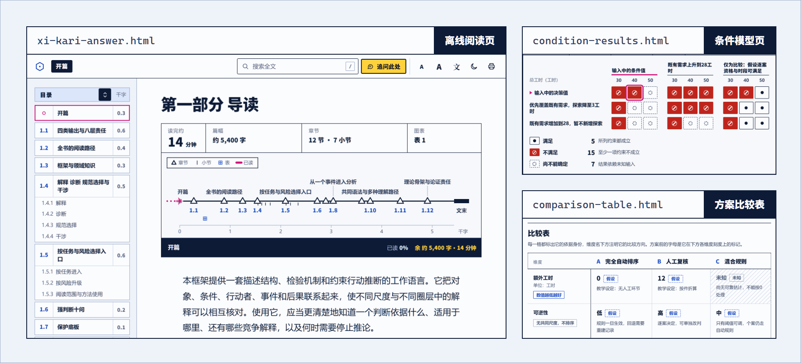
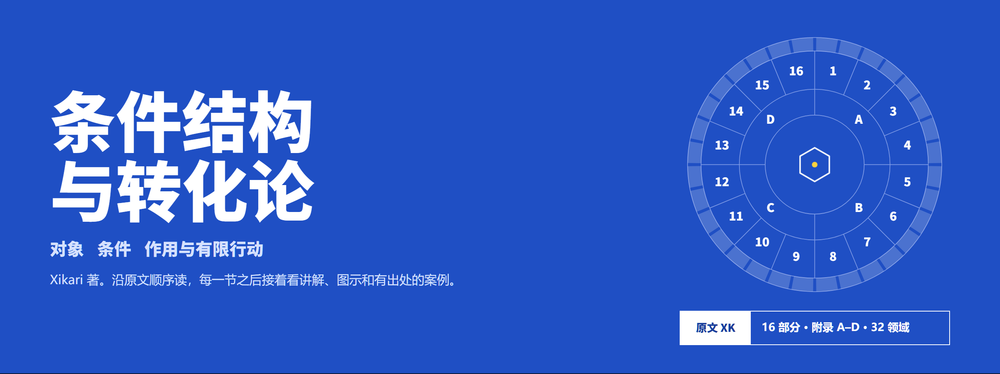

<p><a href="https://xi-kari.github.io/xi-kari-skill/">
  <picture>
    <source media="(prefers-color-scheme: dark)" srcset=".github/readme/hero-en-dark.png">
    
  </picture>
</a></p>

<p align="center">
  <b>English</b> · <a href="README.md">中文</a>
</p>

<p align="center">
  <a href="https://github.com/xi-kari/xi-kari-skill/releases/latest"><b>Download</b></a>&nbsp;·
  <a href="https://xi-kari.github.io/xi-kari-skill/">Project&nbsp;page&nbsp;(Chinese)</a>&nbsp;·
  <a href="https://xi-kari.github.io/xi-kari-skill/handbook/">Reading&nbsp;site&nbsp;(Chinese)</a>&nbsp;·
  <a href="docs/INSTALL.md">Installation&nbsp;guide&nbsp;(Chinese)</a>&nbsp;·
  <a href="https://github.com/xi-kari/xi-kari-skill/discussions">Discussions&nbsp;(Chinese)</a>
</p>

<p align="center">
  <a href="https://github.com/xi-kari/xi-kari-skill/releases/latest"></a>
  <a href="https://github.com/xi-kari/xi-kari-skill/actions/workflows/windows.yml"></a>
  
  <a href="LICENSE"></a>
</p>

**Xikari Skill** is an agent skill. Its theory source is Xikari's *Xikari: On Conditions, Structure, and Transformation* (《Xikari-条件结构与转化论》), and it combines, question by question, source-text answers, explanation, projection, conditional foresight, bounded choice, institutional drafting, theory assessment and the generation of candidates. Eleven method modules carry materials, objects, mechanisms, paths, options and candidates through to complete judgments that state their reasons and can be argued against.

It is built for questions that need both clear thinking and a decision: why an institution keeps failing, how a plan will affect different people, which of several explanations holds up, whether to keep, adjust, probe or exit now. The skill starts only when you name it and does not take over ordinary conversation.

The skill works in English and Chinese. Ask in English and the whole answer is in English. The theory's authoritative text is Chinese; the package also carries an aligned English reference edition and a Chinese–English glossary, used for English terminology and quotations (see [Working in English](references/english.md)).

## Start here

| You want to | Go to |
| --- | --- |
| Install it and ask a first question | [Quick start](#quick-start) · [Installation guide](docs/INSTALL.md) (in Chinese) |
| See how it handles different kinds of question | [Modules organized by question](#modules-organized-by-question) · [Project page](https://xi-kari.github.io/xi-kari-skill/) (in Chinese) |
| Read the theory itself | [English reference edition](source/en/Xikari-On-Conditions-Structure-and-Transformation.md) · [Reading site](https://xi-kari.github.io/xi-kari-skill/handbook/) (in Chinese) |
| Know what it delivers and which tools come with it | [What you get](#what-you-get) · [Bundled tools](#bundled-tools) |
| Know what it does not claim and does not do | [Conditional foresight and its limits](#conditional-foresight-and-its-limits) · [Boundaries](#boundaries) |
| Work in English | [Working in English](references/english.md) · [Glossary](references/glossary-en.md) |
| Change it or take part | [Contributing](#contributing) · [CONTRIBUTING.md](CONTRIBUTING.md) (in Chinese) |

## What makes it different

- **Reading matched to responsibility.** By default the agent studies the whole book in the Chinese original, also when you work in English. With an explicit `layered` choice it does an experimental layered reading of the shared core, the modules used and the anchors of the rule cards. Whole-book assessment, transfer of the framework and tasks of uncertain scope still require full reading. There is no empirical evidence yet that layered reading is equivalent to full reading; reading the English edition in place of the Chinese is likewise only an explicitly authorized experiment.
- **Modules combined by the kind of output.** Questions about the source text can be answered directly; explanation, projection, foresight and choice each add only the conditions they actually depend on.
- **Breadth where it matters, depth in the mechanisms.** The agent first identifies the important situations, competing representations and branches not yet explored, then connects the key causal, resource and normative relations. A route limits the standing of a judgment; it does not cap the length or the range of perspectives of the argument.
- **Willing to judge, and to make judgments that hold up to rebuttal.** It gathers primary or traceable material proportionate to the question and looks for the strongest competing explanations, counterexamples and objections. It separates facts, structure, mechanisms, values and authorization, gives a clear verdict and constructive proposals, and says what new facts would change them.
- **Complete delivery, sized to the question.** The conclusion and key numbers come first. A question with a definite answer gets one or two paragraphs of grounds and conditions; a complex analysis is developed in full, and a long text is written when you ask for one. Clauses and plans are written to be used as they stand, with the explanation after them.
- **One question can keep going.** Follow-ups, new material, counterexamples and requests for a combined draft all build on the existing work and revise from the earliest affected point instead of starting over each turn.
- **It derives further from what is established, and says how far each step reaches.** Ask what else follows, and it works along the definitions, transformations and compositions of the source text to statements the question never asked for. Each one names its starting points and how it was reached, and whether it is a consequence that must hold within a stated model, a requirement a definition places on a claim, or a candidate still to be tested, with its strongest rival and the observation that would reject it. A restatement does not count as new, and *not found* always names the scope searched.

## Quick start

The host must be able to read the complete Markdown files in the package, keep or restore the context of a long task, and output complete answers. Web search, Python and multi-agent collaboration use whatever the host already provides.

1. **Download.** Open the [latest release](https://github.com/xi-kari/xi-kari-skill/releases/latest) and get the Windows package (`xi-kari-skill-<version>-windows.zip`). The same page has the per-file list `install-manifest.json` and `SHA256SUMS`; compare the hash of your download with that version's `SHA256SUMS`:

   ```powershell
   Get-FileHash -Path .\xi-kari-skill-*-windows.zip -Algorithm SHA256
   ```

   Use the release package. “Code → Download ZIP” on the repository page contains tests, the website and development files; it is not meant for a skills directory.

2. **Install.** Unzipping gives a `xi-kari-skill` folder. Put the whole folder into the host's skills directory so that the entry point is `<skills directory>/xi-kari-skill/SKILL.md`:

   | Host | Skills directory | How to invoke |
   | --- | --- | --- |
   | Codex | `.agents/skills/` in your user folder or in the project | `$xi-kari-skill` |
   | Claude Code | `.claude/skills/` in your user folder or in the project | `/xi-kari-skill` |
   | Other local agents that support Agent Skills | the skills root the host actually uses | have the host load that directory's `SKILL.md` |

3. **Name it.** Reload skills or open a new conversation, name the skill, and give it the question together with the material:

   ```text
   /xi-kari-skill After we cut expense approval from three levels to one,
   rejected claims and complaints went up.
   Attached are six months of tickets and the process change log.
   Where is the problem, which explanations compete, and what changes can we actually make?
   ```

   In Codex start with `$xi-kari-skill`; in other hosts you can write “Use xi-kari-skill to analyze…”.

In the default full-reading mode the first turn includes complete study of the Chinese text. For the experimental layered reading, say “use layered reading” in the request; its core list and supplementary reading are in the [reading rules](references/full-source-study.md) (in Chinese). Follow-ups, additions and revisions on the same question continue from the existing work. Backups before upgrading and notes for other hosts are in the [installation guide](docs/INSTALL.md) (in Chinese).

## Modules organized by question

<p><picture>
  <source media="(prefers-color-scheme: dark)" srcset=".github/readme/routes-en-dark.png">
  
</picture></p>

| Route | Request | How it is carried |
| --- | --- | --- |
| R1 | Source text and concepts | read the complete definition and its dependencies, answer directly |
| R2 | Explanation and diagnosis | question, materials, objects, mechanisms, counterarguments, composition |
| R3 | Projection | freeze the conditions, unfold the paths, keep the signals and stopping points |
| R4 | Conditional foresight | complete the projection, register before the outcome, check and write back after it |
| R5 | Bounded choice | build on an existing explanation or path and compare six kinds of options |
| R6 | Drafting institutions and plans | give a draft for deliberation, resource arrangements and conditions for revision |
| R7 | Theory assessment | read the whole book, then assess its relations and competing methods |
| R8 | Generation | start from analysis already in hand and derive candidates that carry their origin and a test |

The detailed order is in [routing](references/routing.md) and the [eleven modules](references/forward-workflow.md) (in Chinese). Modules hand over substance; a separate handover file is saved only when collaboration, review or recovery needs it. Registration before the outcome is required for conditional foresight and must be kept. Older drafts and discussions use the earlier stage names XK0–XK11; [their mapping to modules](references/forward-workflow.md#旧工作名称的定位) (in Chinese) explains them. The skill no longer runs through those stages in order.

R8 is for the moment when the explanation is already in hand and the question is what else follows from it. It needs starting points: analysis from the same task is taken up as it stands, and without one the minimum work on materials, objects and mechanisms is done first. Every item comes back with its origin and its standing — a consequence that must hold within a stated model, a condition a claim must still meet by definition, a candidate awaiting a test, an analogy that only says where to look, a new question or a proposal — together with its strongest rival, a test and the observation that would reject it. The method is in the [generation guide](references/generation.md) (in Chinese).

```text
$xi-kari-skill Attached are six indicators from the first year of the hotline reform and the city's summary.
No need to explain the numbers again. What follows from them that nobody has asked: conclusions, questions or ideas, above all ones that can be checked?
```

## Conditional foresight and its limits

**The foresight tools work; their accuracy has not been validated.**

The [foresight module](modules/forecast/MODULE.md) (in Chinese) runs from eligibility checks, a frozen snapshot, mechanisms and paths through expression, registration, the handover to options, and write-back at resolution. Thirty-nine [derived rule cards](rules/README.md) (in Chinese) give retrieval and usage prompts; using one means going back to the complete source section. All cards are currently drafts awaiting the author's sampled review.

`scripts/forecast.py` provides `register`, `list`, `show`, `resolve`, `report` and `check`. Registration fixes the target, horizon, scope and input cutoff; outcomes are only appended; orders one to three are scored separately and compared with a pre-registered simple baseline. Reports support Brier score, log loss, direction and top-rank hits, interval scores and forecast windows where they apply, with paired baseline comparison and statistics on disagreement subsets; inapplicable or missing labels are never filled with zero.

The [public resignation teaching case](cases/forecast-public-resignation.md) (in Chinese) shows every step with separate records for each order; teaching and synthetic results do not count as evidence of ability. No information-isolated real backtest has been completed, and the author has not fixed non-inferiority bounds or reading tolerances, so no claim can be made that the forecasts beat ordinary models, Xikari Skill 5.5.1 or a simple baseline. Retrieval structure, file checks and software tests prove only the behavior they check.

## One question, as far as you want to take it

An answer can be the start of continued joint work. Just keep talking:

| You can say | What the skill does next |
| --- | --- |
| “Here is a new document…” | judges the material's source, date, scope and conflicts first, then updates only the models, mechanisms, paths and verdicts it actually affects |
| “I disagree, because…” | goes back to the source and the disputed inference, looks for the smallest counterexample or the missing premise, and keeps, narrows, revises or withdraws the judgment with reasons, updating what depends on it |
| “The goal changed” / “there is a new constraint” | states what changed, then redoes the affected feasibility, consequences and trade-offs without rewriting what already happened |
| “Go deeper” | picks a relation not yet explained and actually develops it, saying why it starts there, instead of listing a menu of next steps |
| “Just discuss; don't change the draft” | keeps the current main draft and explains the effect in the reply |
| “Combine into a full draft” / “export to Word” | gathers all valid analysis into a complete master draft, and exports `.docx` when needed |

Long tasks can continue across sessions. When the session or model changes, the new lead author first completes their own full study and then inherits the sourced material and results instead of starting over. When several agents collaborate, every author who forms an independent judgment reads the whole book first and then takes a share of the question; supporting work such as searching, recalculating, drawing and layout can be delegated, and the lead author makes the final choices and assembles the result.

## What you get

<p><picture>
  <source media="(prefers-color-scheme: dark)" srcset=".github/readme/outputs-dark.png">
  
</picture></p>

<sub>The screenshots were produced by the bundled tools, with Chinese interfaces. The reading page uses Part 1 of the book as sample content; the condition-model page and comparison table come from the bundled, explicitly fictional teaching examples, whose numbers are not real-world facts.</sub>

**Version scope:** the current package is `v6.2.0`; the screenshots show the tools' interfaces, and each version's features are described in its [release notes](https://github.com/xi-kari/xi-kari-skill/releases).

- **Complete answer `xi-kari-answer.md`.** Produced at the first complete delivery or when you ask for a combined draft: the central judgment first, then evaluation of the material, structural relations, comparison of mechanisms, cases and counterexamples, paths, responses to objections, the verdict and the options.
- **Offline reading page.** A single HTML file, generated from the complete draft, that makes no network connections. Under the title a track chart, drawn from the text's own counts, sets each section as a fix at its true distance; the track fills in as you read, pressing a fix goes to that section, and once the chart has scrolled away the same track stays in view under the bar. The contents list marks the current section as you read; there is full-text search, adjustable text size and a print layout; night mode follows the system and can be switched by hand; footnotes preview on hover and link back. Select a passage and “Ask about selection” turns it, with its location, into a follow-up question for you to copy back into the conversation. Formulas are typeset with the bundled KaTeX. Use `--lang en` for an English interface.
- **Word document.** Keeps the text, tables, footnotes and local images; remote images are not downloaded but kept as visible text; anything that cannot be represented is kept as written and listed. Use `--lang en` for English labels and an English document language.
- **Research products on demand.** A claim ledger, a candidate ledger, option comparison tables, study designs and collection notes, condition-model pages, task state across turns, a case library. They are produced when the work needs them, not as a fixed step of every analysis.

## Bundled tools

All tools are optional Python scripts that use only the standard library and need Python 3.10 or later; for PDF material you can install `pypdf` or use the host's document tools. The tools handle only the material, calculations or text explicitly given to them. They cannot prove that the model understands the theory, nor prove real-world causation or that an option is justified.

| Tool | Use | Deliberately does not |
| --- | --- | --- |
| `read_source.py` | read the full text chunk by chunk, re-read sections by number, locate terms; `--front` for the front matter alone, `--lang en` for the English edition, `--parallel` (with `--section`, `--part` or `--front`) for the Chinese and then the English text of the same range | count chunks or identity checks as reading |
| `evidence.py` | register versions of material and keep selected excerpts with their scope of support | download from the web or judge whether material is credible |
| `claims.py` | claim ledger: grounds, reasons, conditions for revising, open disagreements | score or decide truth |
| `candidates.py` | candidate ledger: each candidate's starting points, move, standing, rivals and state of testing | judge whether a candidate is true or new, or let one skip testing |
| `comparison.py` | option comparison tables as JSON, Markdown and HTML, marking facts, assumptions and unknowns; `--lang en` for English labels | rank unknowns or name an overall best option |
| `study_design.py` | turn open questions into observations and collection plans that can tell explanations apart | fill in defaults for missing data |
| `condition_lab.py` | run explicit formulas and constraints and export a page for switching among all computed combinations | interpolate, or present model results as feasible in reality |
| `manuscript.py` | draft snapshots, diffs, merging non-overlapping edits, tracking dependencies | decide for the author whether meaning carries over |
| `task_state.py` | record across turns what is decided, open, due for review or withdrawn | record your approval as a fact |
| `casebook.py` | build a case library in a directory you choose | write to global memory or presume structural similarity |
| `render_answer.py` | generate the offline reading page | add, remove or reorder text |
| `render_docx.py` | export a Word document | download remote images |

PowerShell examples. `$skillRoot` is the skill directory the host actually loads; `$taskRoot` is a task directory of your choice outside the skill directory:

```powershell
python "$skillRoot/scripts/read_source.py" --chunks
python "$skillRoot/scripts/read_source.py" --chunk 1
python "$skillRoot/scripts/read_source.py" --parallel --section 4.17
python "$skillRoot/scripts/read_source.py" --lang en --search 'effective feedback' --context 2
python "$skillRoot/scripts/render_answer.py" "$taskRoot/xi-kari-answer.md" --output "$taskRoot/xi-kari-answer.html" --lang en
python "$skillRoot/scripts/render_docx.py" "$taskRoot/xi-kari-answer.md" --output "$taskRoot/xi-kari-answer.docx" --lang en
python "$skillRoot/scripts/comparison.py" "$taskRoot/compare.json" --output "$taskRoot/compare" --format all
```

Common invocations are in [host setup and clean working directories](references/host-setup.md) (in Chinese); the commands of `manuscript.py`, `casebook.py`, `candidates.py` and `forecast.py` are in [manuscript work](references/manuscript-work.md), [the case library](references/case-library.md), [the candidate ledger](references/candidate-ledger.md) and [the foresight module](modules/forecast/MODULE.md) (all in Chinese). Before creating any file, directory, lock or temporary file, every bundled tool that writes files, `forecast.py` included, refuses targets inside the skill installation directory and checks directory links and `..` paths. This is the tools' own write restriction, not an operating-system sandbox.

## Source text and reading

<p><a href="https://xi-kari.github.io/xi-kari-skill/handbook/">
  <picture>
    <source media="(prefers-color-scheme: dark)" srcset=".github/readme/handbook-dark.png">
    
  </picture>
</a></p>

| The book | What it covers |
| --- | --- |
| [Parts 1–2](source/en/Xikari-On-Conditions-Structure-and-Transformation.md#part_1) | reading method and evidential responsibility |
| [Parts 3–6](source/en/Xikari-On-Conditions-Structure-and-Transformation.md#part_3) | universal grammar, conditional propositions, empirical testing, scale transformation and mechanisms of operation |
| [Parts 7–11](source/en/Xikari-On-Conditions-Structure-and-Transformation.md#part_7) | human experience, collective prototypes, actors, multi-circle objects and dynamic projection |
| [Parts 12–16](source/en/Xikari-On-Conditions-Structure-and-Transformation.md#part_12) | foresight, choice, tools, norms, intervention and governance |
| [Appendices A–D](source/en/Xikari-On-Conditions-Structure-and-Transformation.md#part_17) | Human Variable Interface Cards; Numbering Scheme and Glossary; Common Method Kernel and Cross-Disciplinary Bridging; A Map of Domain Explanations and Applications |

- **Authoritative text:** [`source/Xikari-条件结构与转化论.md`](source/Xikari-条件结构与转化论.md), with its identity (SHA-256) in [`source/source-manifest.json`](source/source-manifest.json). The source takes precedence over the skill's engineering guidance and over a model's prior understanding of terms with the same name.
- **English reference edition:** [`source/en/Xikari-On-Conditions-Structure-and-Transformation.md`](source/en/Xikari-On-Conditions-Structure-and-Transformation.md). It is translated from that authoritative text, shares every section and part identifier with it, and records the Chinese SHA-256 it translates in [`source/en/source-manifest.json`](source/en/source-manifest.json). It is a reference translation: where it appears to differ from the Chinese, the Chinese governs. Terms are listed in the [Chinese–English glossary](references/glossary-en.md).
- **[Term index](source/en/Xikari-On-Conditions-Structure-and-Transformation.md#part_18):** the numbering scheme and glossary of Appendix B.
- **[Reading site](https://xi-kari.github.io/xi-kari-skill/handbook/)** (in Chinese): read the source in order, with explanations, diagrams and sourced cases after each section; search concepts, cases and the text, or [download](https://xi-kari.github.io/xi-kari-skill/handbook/downloads.html) the full Chinese text as Markdown or Word.
- **[Concept lessons](https://xi-kari.github.io/xi-kari-skill/handbook/concepts/)** and **[real cases](https://xi-kari.github.io/xi-kari-skill/handbook/cases/)** (in Chinese): from a question to a distinction — for example, “Do comments received already count as feedback?” — and cases such as the Mars Climate Orbiter's unit interface, Toyota's andon response process, GitLab's database recovery, the Flint water complaints and Hurricane Ian's forecast cone; the case index offers reading routes by question.
- **[Historical field tests](https://github.com/xi-kari/xi-kari-skill/discussions?discussions_q=)** (in Chinese): Discussions keep historical analyses based on Xikari 8.3 for reference; they do not represent the current theory or the current skill.
- **[Project page](https://xi-kari.github.io/xi-kari-skill/)** (in Chinese): introduction, usage and research progress.

## Boundaries

- **Starts only when named.** [`agents/openai.yaml`](agents/openai.yaml) disables implicit invocation in Codex; follow-ups on the same question continue naturally, and unrelated requests are not taken over.
- **Leaves your environment alone.** It installs no model backend, resident service or scheduled task and does not change the host's model, permissions, global configuration or memory; it does not run in the background, publish automatically or contact anyone.
- **Read-only skill directory.** Drafts, material folders, case libraries, model results and generated pages go to the task directory you specify.
- **You decide the scope of material.** By default it actively gathers the real-world material the question needs; when you limit it to the material you provide, it keeps to that and says honestly what is missing.
- **Material is not instruction.** The source text, your material and external sources never acquire the host's instruction authority.
- **Evidence sets the strength of a claim.** Speculation, analogy, invention and foresight state their grounds and conditions; missing material limits only the conclusions that depend on it. The theory itself can receive grounded criticism and revision proposals; it cannot prove itself universally right in its own terms.
- **What has been verified.** Tool tests cover Windows, including Chinese and space-containing paths and running from other working directories; CI uses Python 3.10 and 3.13. Other operating systems and cloud products have not been tested.

## Repository layout

```text
xi-kari-skill/
├── SKILL.md              skill entry point: reading modes and the eight routes
├── source/               theory source and identity manifest (authoritative text)
│   └── en/               English reference edition and its manifest
├── modules/              eleven analysis, judgment and generation modules
├── rules/                39 derived rule cards with source anchors
├── cases/                teaching demonstrations and runnable registration inputs
├── references/           guides: reading, modules, continuation, collaboration, tools, English
├── scripts/              optional Python tools (standard library); build, check, evaluation
├── assets/               styles, scripts and sample data for the generated pages; bundled KaTeX
├── agents/openai.yaml    Codex interface information and explicit-invocation policy
├── skill-package.json    per-file list of the install package
├── website/              reading-site source (VitePress), built to docs/handbook/
├── docs/                 project page, installation guide and maintenance notes
├── DESIGN.md             design system of the project page, the reading site and the generated pages
└── tests/                unit tests and page interaction tests
```

The install package contains only the runtime resources listed in `skill-package.json`: no development documents, tests, website, run records or personal cases.

## Contributing

- Problems in use and concrete improvements: [Issues](https://github.com/xi-kari/xi-kari-skill/issues/new/choose) (forms in Chinese)
- Theory discussion, experience and open questions: [Discussions](https://github.com/xi-kari/xi-kari-skill/discussions) (in Chinese), organized by topics such as philosophy and existence, cognition and truth, technology ethics and social change, political economy and justice, civilization and crisis, and deep practical questions
- Integrity and trust-boundary problems (a tampered package, a bypass of source identity checks, script injection in the offline pages, reading or writing outside allowed paths): report privately under the [security policy](SECURITY.md) (in Chinese), not in a public issue.

Development happens on Windows; CI uses Python 3.10, 3.13 and Node.js 22.x. After changing tools, source reading or the install list:

```powershell
python -m pip install pypdf==6.19.0
npm ci --prefix tests/dom --ignore-scripts --no-audit --no-fund
python -m unittest discover -s tests -v
python scripts/read_source.py --check
python scripts/build_english_edition.py --check
python scripts/build_install_package.py --output <a directory outside the repository>
```

The reading site is built to `docs/handbook/` with `npm ci --prefix website` and `npm run build --prefix website`. Revisions of the theory text are committed separately from engineering changes; the boundaries and checks for each kind of change are in [CONTRIBUTING.md](CONTRIBUTING.md) (in Chinese) and [docs/MAINTAINING.md](docs/MAINTAINING.md).

## License

This repository is released under the [MIT License](LICENSE), © 2026 xi-kari. The bundled KaTeX keeps its [license](assets/vendor/katex/LICENSE); third-party resources of the reading site are listed in [THIRD_PARTY_NOTICES.txt](website/public/THIRD_PARTY_NOTICES.txt), and the font subsets of the project page are cut from Noto Sans SC and Noto Serif SC, whose [license](docs/assets/fonts/OFL.txt) is kept with the files.

<br>

<p align="center">
  <sub>Xikari · 柊東雲 / Hiiragi Shinonome · <a href="https://xi-kari.com/">Blog&nbsp;(Chinese)</a> · <a href="https://xi-kari.github.io/xi-kari-skill/">Project&nbsp;page&nbsp;(Chinese)</a></sub>
</p>
