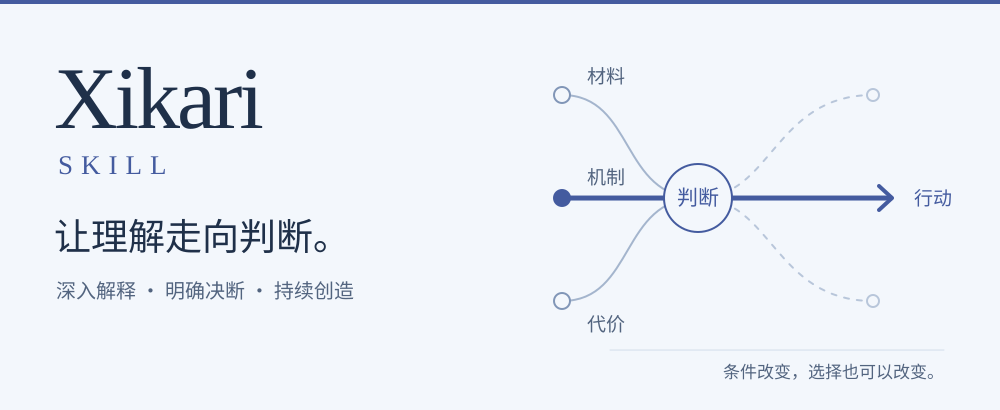

  <picture>
    <source media="(max-width: 600px)" srcset="docs/assets/readme-cover-mobile.svg">
    
  </picture>

  <strong>深入理解一个问题，作出明确判断，把答案继续做下去。</strong>

  <a href="https://xi-kari.github.io/xi-kari-skill/">认识 Xikari</a> ·
  <a href="https://xi-kari.github.io/xi-kari-skill/handbook/">概念、案例与原文</a> ·
  <a href="https://github.com/xi-kari/xi-kari-skill/discussions?discussions_q=">案例实测</a> ·
  <a href="https://github.com/xi-kari/xi-kari-skill/releases/latest">获取技能</a> ·
  <a href="source/Xikari-条件结构与转化论.md">阅读理论</a>

Xikari Skill 以 **Xikari 著《Xikari-条件结构与转化论》** 为基础，让智能体完整学习理论后，进入真实问题：解释事情为什么发生，比较不同选择会带来什么，提出有理由的判断与具体方案。一次完整回答，也可以成为持续研究与共同创作的起点。

## 看公开的案例实测

Discussions 保存了 **17 篇基于 Xikari 8.3 的历史实测案例**。其中可能存在分析、推演或判断上的问题，保留作历史参考，不代表当前《Xikari-条件结构与转化论》及现行 Skill 的分析表现。

可以直接阅读当时的完整分析：

- [算法治理的民主悖论](https://github.com/xi-kari/xi-kari-skill/discussions/5)
- [教育的本质困境](https://github.com/xi-kari/xi-kari-skill/discussions/10)
- [数字永生的伦理困境](https://github.com/xi-kari/xi-kari-skill/discussions/6)
- [翁法罗斯完整剧情与结构解读](https://github.com/xi-kari/xi-kari-skill/discussions/25)

[浏览全部运行实录与讨论 →](https://github.com/xi-kari/xi-kari-skill/discussions?discussions_q=)

## 看懂复杂问题

把分散的事实连成可以理解的关系：事情依赖哪些条件，什么机制正在起作用，表面的变化怎样传到更远的地方，谁受益、谁承担代价。遇到相似案例的不同结果，继续追问差异从哪里来。

**你可以交给它：** 一场公共争论、一项技术变化、一个组织困境、一段历史过程，或一件始终解释不清的事。

## 作出有理由的决断

比较现实选项，认真处理最强反方，明确推荐什么、放弃什么，以及为什么。把选择展开成资源、责任、步骤和适用条件；关键事实变化时，说明哪部分判断需要改变。

**你可以得到：** 方案比较、行动计划、规则修订、可审议的法律条文或相互衔接的制度设计。

## 批判现有解释，也提出新构想

辨认一个论点成立的部分，指出前提、证据或实施中的具体问题。通过反例、反事实、跨领域比较和条件变化，寻找被忽略的解释与新的解决办法。大胆提出构想，再讲清它的机制、代价和可行起点。

**你可以继续问：** “换一个位置看会怎样？”“最强的反对理由是什么？”“除了已有选项，还能怎样设计？”

## 把研究推进到能做的事情

| 面对的任务 | Xikari 可以做的工作 |
| --- | --- |
| 材料多，意见互相冲突 | 定位原文、比较来源、保存关键片段，说明材料支持哪项判断 |
| 几种解释都说得通 | 找到真正的分歧，提出能区分它们的新材料、观察或研究设计 |
| 方案受多个条件限制 | 建立明确的条件模型，计算情景与组合，比较结果和未知项 |
| 一个局部问题牵动全局 | 展开跨角色、跨层级和跨时间的影响，识别依赖、反馈与潜在后果 |

## 在连续对话中，一起把作品做深

带着已有结论继续讨论。补充材料、提出反例、改变目标或加入新约束，都能成为深化的入口。需要协作时，由各自完整学习理论的智能体分工研究，再汇合证据、比较分歧、形成共同成果。

> **第一轮**　解释问题，提出判断与方案。
>
> **继续讨论**　接入新材料，展开争议，探索其他可能。
>
> **打磨成稿**　保留有效论证，将成熟修改合入完整作品。

可以只讨论一个疑点，也可以保存另一条方案分支；可以逐段修改，也可以完成整篇重构。已有成果随着研究继续发展。

## 交付完整、清楚、可以继续使用的成果

**深度分析文章 · 批评与评论 · 决策方案 · 行动计划 · 规则与制度草案 · 研究构想 · 条件模型 · 可持续积累的案例**

复杂问题充分展开，不预设答案只能有几千字。用真实案例、清楚的语言、必要的因果图与比较表支撑解释；需要阅读与分享时，生成带目录、搜索、公式、脚注和选段追问的离线阅读页。每项结论都能回到它的材料、理由与成立条件。

---

[安装与适配](docs/INSTALL.md) · [项目介绍与研究](https://xi-kari.github.io/xi-kari-skill/#research) · [交流与讨论](https://github.com/xi-kari/xi-kari-skill/discussions?discussions_q=)
