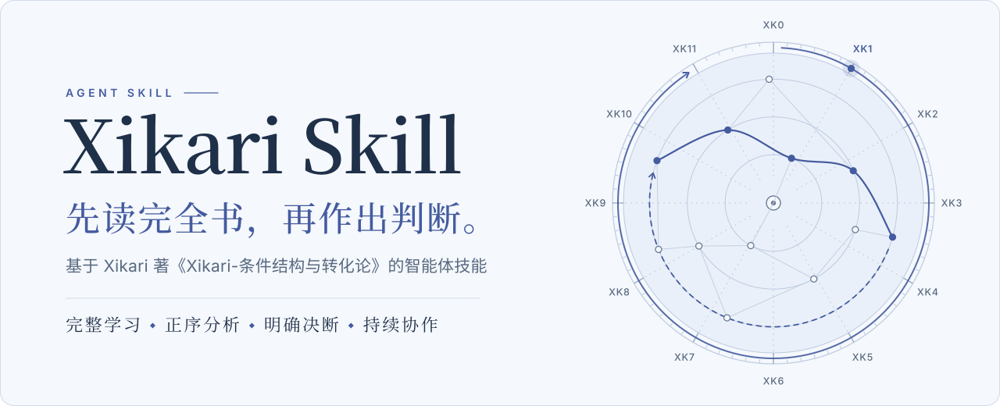
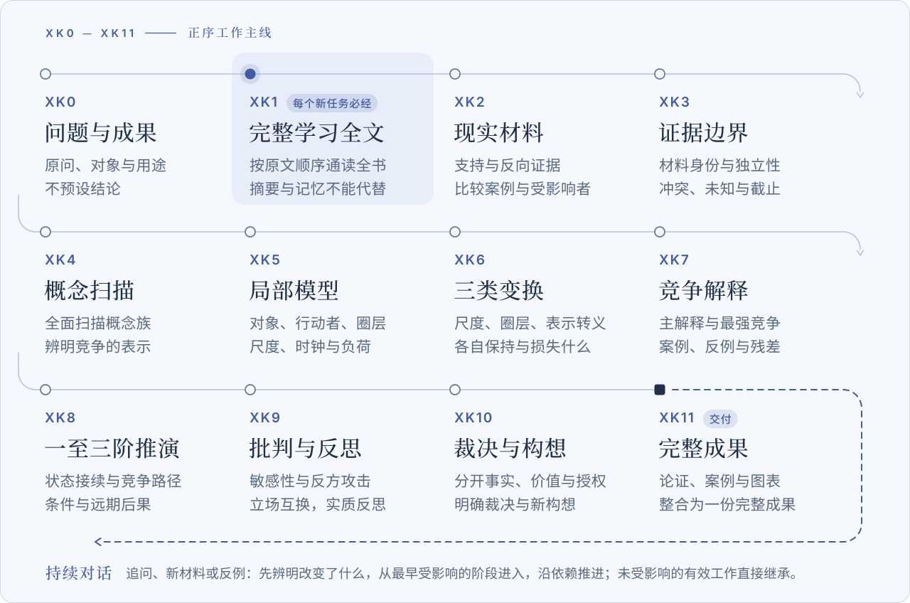
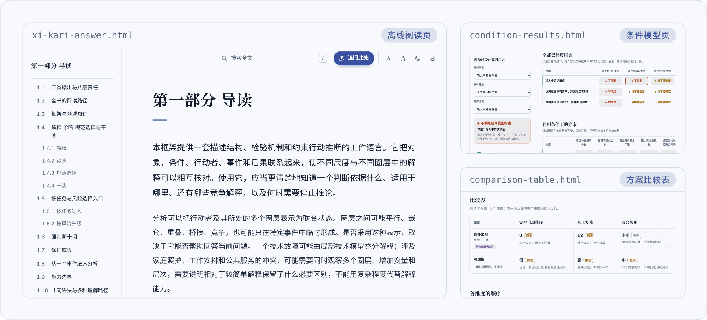
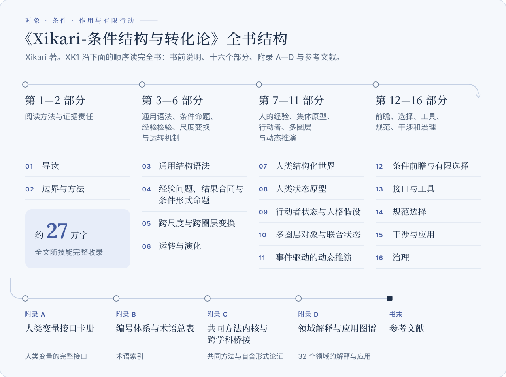

<picture>
  <source media="(prefers-color-scheme: dark)" srcset=".github/readme/hero-dark.svg">
  
</picture>

<p align="center">
  <a href="https://github.com/xi-kari/xi-kari-skill/releases/latest"><b>下载安装包</b></a>
  &nbsp;·&nbsp;
  <a href="https://xi-kari.github.io/xi-kari-skill/handbook/">原文精读</a>
  &nbsp;·&nbsp;
  <a href="https://xi-kari.github.io/xi-kari-skill/">项目主页</a>
  &nbsp;·&nbsp;
  <a href="docs/INSTALL.md">安装指南</a>
  &nbsp;·&nbsp;
  <a href="https://github.com/xi-kari/xi-kari-skill/discussions">讨论区</a>
</p>

<p align="center">
  <a href="https://github.com/xi-kari/xi-kari-skill/releases/latest"></a>
  <a href="https://github.com/xi-kari/xi-kari-skill/actions/workflows/windows.yml"></a>
  
  <a href="LICENSE"></a>
</p>

**Xikari Skill** 是一个智能体技能（Agent Skill）。它把 Xikari 著《Xikari-条件结构与转化论》的完整正文随包交给智能体，并规定一套做事的顺序：每接到一个新的分析任务，先按原文顺序读完全书，再沿 XK0—XK11 十二个阶段辨认材料、建立模型、比较解释、推演后果、接受反驳，最后作出有理由的判断，把全部论证写成一份完整成果。

它为需要想清楚、也需要下判断的问题而设计：一项制度为什么反复失灵，一个方案会怎样影响不同的人，几种解释里哪一种站得住，现在该维持、调整、试探还是退出。技能只在你明确点名时启用，不会接管日常对话。

## 它有什么不同

- **先读完全书，再谈具体问题。** 书中概念的定义、适用条件、排除项和反例分布在不同章节，同名不等于同义。所以每个新任务，负责最终判断的智能体都要按原文顺序读完书前说明、十六个部分、附录 A—D 和参考文献；目录、概念摘要、旧回答、模型记忆和子智能体的读后报告都不能代替这一步。
- **按 XK0—XK11 的顺序推进。** 不因为已经猜到结论、想省 token 或想快一点就跳过阶段；某项方法确实不适用时，要说明具体原因。
- **敢下判断，也让判断经得起反驳。** 主动取得与问题相称的一手或可追溯材料，寻找最强的竞争解释、反例和反方；分开事实、结构、机制、价值与授权，给出明确裁决和建设性构想，并写明什么新事实会改变它。
- **完整交付，不设默认字数上限。** 先给中心判断，再展开材料、机制、路径、反方、方案和理由。复杂问题需要上万字就写上万字，简单问题也不靠重复凑长。
- **同一个问题可以一直往下做。** 追问、补材料、提反例、要求合稿，都接着已有成果推进，从最早受影响的地方修订，而不是每轮从头开始。

## 快速开始

宿主需要能读取包内的完整 Markdown、保持或恢复长任务上下文，并输出足够完整的答案；联网检索、Python 和多智能体协作都使用宿主已有的能力。

1. **下载。** 打开[最新正式 Release](https://github.com/xi-kari/xi-kari-skill/releases/latest)，取得附件中的 Windows 安装包（`xi-kari-skill-<版本号>-windows.zip`）。同一页面附有逐文件清单 `install-manifest.json` 和 `SHA256SUMS`；运行下面的命令，将下载文件的哈希与该版本的 `SHA256SUMS` 对照：

   ```powershell
   Get-FileHash -Path .\xi-kari-skill-*-windows.zip -Algorithm SHA256
   ```

   请使用 Release 安装包。仓库页面的 “Code → Download ZIP” 包含测试、网站和开发文件，不是给技能目录用的。

2. **安装。** 解压得到一个 `xi-kari-skill` 文件夹，把整个文件夹放进宿主的技能目录，让入口位于 `<技能目录>/xi-kari-skill/SKILL.md`：

   | 宿主 | 技能目录 | 调用方式 |
   | --- | --- | --- |
   | Codex | 用户目录下的 `.agents/skills/`，或项目内的 `.agents/skills/` | `$xi-kari-skill` |
   | Claude Code | 用户目录下的 `.claude/skills/`，或项目内的 `.claude/skills/` | `/xi-kari-skill` |
   | 其他支持 Agent Skills 的本地智能体 | 宿主实际配置的技能根目录 | 让宿主加载该目录的 `SKILL.md` |

3. **点名使用。** 重新加载技能或开一个新对话，点名调用，把问题和材料一起交给它：

   ```text
   $xi-kari-skill 报销审批从三级改成一级以后，退单和投诉反而更多了。
   附件是近半年的工单和流程变更记录。
   请判断问题出在哪一环，比较可能的解释，并给出可以执行的调整方案。
   ```

   在 Claude Code 中把开头换成 `/xi-kari-skill`；其他宿主可以直接写“使用 xi-kari-skill 分析……”。

第一次分析要先完整学习全书，所以首轮会比普通对话慢得多；之后同一个问题的追问、补充和修改都接着已有成果推进。升级前的备份方式和其他宿主的说明见[安装指南](docs/INSTALL.md)。

## 一次完整分析怎样推进

<picture>
  <source media="(prefers-color-scheme: dark)" srcset=".github/readme/workflow-dark.svg">
  
</picture>

<details>
<summary><b>十二个阶段各做什么</b></summary>
<br>

| 阶段 | 实际工作 |
| --- | --- |
| XK0 | 明确原问、对象、用途、范围、资料截止与所需成果，不预设结论 |
| XK1 | 主作者完整阅读学习理论全文，掌握自定义概念及关联 |
| XK2 | 取得现实材料、支持与反向证据、比较案例及受影响者资料 |
| XK3 | 辨别材料身份、支持范围、独立性、冲突、未知与证据边界 |
| XK4 | 全面扫描理论概念族与领域入口，辨明本题相关概念、依赖与竞争表示 |
| XK5 | 建立对象、行动者、圈层、尺度、通道、时钟、负荷与历史载体的局部模型 |
| XK6 | 分析尺度变化、圈层关系变化、表示与表达转义及各自保持和损失 |
| XK7 | 比较命题、机制、简单基线、混合解释、残差解释、案例与反例 |
| XK8 | 展开适用的一至三阶状态接续、竞争路径、条件与远期后果 |
| XK9 | 进行逐阶比较、敏感性分析、反方攻击、立场互换与实质反思 |
| XK10 | 分开事实、结构、机制前瞻、价值与授权，形成明确裁决、选择和建设性构想 |
| XK11 | 将全部实质分析整合成完整、清楚、有案例和适当视觉表达的成果 |

逐阶段的细则见[正序分析流程](references/forward-workflow.md)。

</details>

XK 编号是工作顺序，不是打卡清单：不要求每个阶段生成文件、通过标记、评分或证书，只要求每一阶段留下能被下一阶段真正使用的内容。原文中的 IG 七闸、IT 转换与 DF 九闸各按自己的定义使用，不与 XK 编号互相替代。

## 同一个问题，可以一直往下做

一篇答案可以成为后续共同研究的起点。接着说下去就行：

| 你可以这样说 | 技能会怎样接着做 |
| --- | --- |
| “补充一份新材料……” | 先判断材料的来源、时点、范围与冲突，再更新真正受影响的模型、机制、路径和裁决；未受影响的部分保留 |
| “我不同意这个判断，因为……” | 回查原文和争议推论，寻找最小反例或必要前提；维持、限缩、修改或撤回都给出理由，并同步依赖它的结论 |
| “目标变了”“多了一个限制” | 先明确改变的是什么，再重做相关的可行性、后果与取舍；不改写已经发生的事实 |
| “再深入一点” | 自主挑出尚未解释清楚的关系实际展开，并说明为什么从这里入手，而不是只列一份下一步菜单 |
| “只讨论，先不改稿” | 保留现行主稿，只在回答里说明影响 |
| “合成完整稿”“导出 Word” | 汇总全部有效分析，交付完整母稿；需要时再导出 `.docx` |

长任务可以跨会话接续。换了会话或模型时，新的主作者先完成自己的全文学习，再继承有来源的材料与成果，不必把已有工作推倒重来。多个智能体协作时，每个独立作判断的作者都先读完全书，再按问题分工；查资料、复算、制图和排版这类辅助工作可以分出去，最后由主作者负责取舍与总装。

## 交付什么

<picture>
  <source media="(prefers-color-scheme: dark)" srcset=".github/readme/outputs-dark.png">
  
</picture>

<sub>截图由当前源码中的工具实际生成：阅读页以原文第一部分为示例内容；条件模型页与方案比较表来自随包的“明确虚构”教学示例，其中的数值不是现实事实。</sub>

**版本范围：**截图与下列功能描述对应 `v5.5.0` 安装包；各版本的功能以相应的 [Release 说明](https://github.com/xi-kari/xi-kari-skill/releases/latest)为准。

- **完整成果稿 `xi-kari-answer.md`。** 初次完整交付或要求合稿时形成：中心判断在前，随后是材料评价、结构关系、机制比较、案例与反例、路径、反方回应、裁决与方案。
- **离线阅读页。** 由完整稿生成的单个 HTML 文件，不联网：章节目录随阅读位置标出当前章节，有全文搜索、字号调节和打印版式；夜间模式默认跟随系统，也可以手动切换；脚注可以悬停预览，也可以回跳。选中一段正文，旁边会出现“追问选段”，把选段连同位置整理成一条追问，由你复制回对话。有公式时内嵌随包的 KaTeX 排版。
- **Word 文档。** 保留正文、表格、脚注和本地图片；远程图片不会下载，而是保留为可见文字；无法表示的写法保留原文并逐项列出。
- **按需的研究产物。** 主张台账、方案比较表、研究设计与采集说明、条件模型页、跨轮次任务状态、案例库。它们在工作需要时才生成，不是每次分析的固定流程。

## 随包工具

工具都是可选的 Python 脚本，只用标准库，需要 Python 3.10 或更新版本；读取 PDF 材料时可以另装 `pypdf`，也可以用宿主已有的文档工具。工具只处理明确交给它们的材料、运算或文本，不能证明模型已经理解理论，也不能证明现实因果或方案正当。

| 工具 | 用途 | 刻意不做的事 |
| --- | --- | --- |
| `read_source.py` | 按块顺序读取全文、按节号复读、关键词定位 | 报告块数或核对原文身份，都不等于读过 |
| `evidence.py` | 登记材料版本，保存选定片段及其支持范围 | 不联网下载，不判断材料是否可信 |
| `claims.py` | 主张台账：依据、理由、改判条件与未决分歧 | 不打分，不判定真伪 |
| `comparison.py` | 方案比较表，输出 JSON、Markdown 与 HTML；事实、假设、未知分别标注 | 未知不参与排序，不给整体最优 |
| `study_design.py` | 把未决问题变成能区分各解释的观察与采集说明 | 缺失保持缺失，不填默认值 |
| `condition_lab.py` | 运行明确的公式与约束，导出可切换全部已计算组合的离散情景页 | 不插值，不把模型结果说成现实可行 |
| `manuscript.py` | 稿件快照、差异、合并不重叠的修改、追踪依赖 | 不替作者判断语义是否接续 |
| `task_state.py` | 跨轮次记录已决定、未决、需复核与已撤回 | 不把用户认可记成事实 |
| `casebook.py` | 在你选定的目录里积累案例 | 不写入全局记忆，不推定结构相似 |
| `render_answer.py` | 生成离线阅读页 | 不增删、不重排正文 |
| `render_docx.py` | 导出 Word 文档 | 不下载远程图片 |

PowerShell 示例。`$skillRoot` 是宿主实际加载的技能目录，`$taskRoot` 是你选定的、位于技能目录之外的任务目录：

```powershell
python "$skillRoot/scripts/read_source.py" --chunks
python "$skillRoot/scripts/read_source.py" --chunk 1
python "$skillRoot/scripts/read_source.py" --search '有效反馈' --context 2
python "$skillRoot/scripts/render_answer.py" "$taskRoot/xi-kari-answer.md" --output "$taskRoot/xi-kari-answer.html"
python "$skillRoot/scripts/render_docx.py" "$taskRoot/xi-kari-answer.md" --output "$taskRoot/xi-kari-answer.docx"
python "$skillRoot/scripts/comparison.py" "$taskRoot/compare.json" --output "$taskRoot/compare" --format all
```

全部命令见[宿主接入与干净工作目录](references/host-setup.md)。十个会写文件的工具在创建文件、目录、锁或临时文件之前，都会拒绝以技能安装目录及其子目录为目标，也会检查目录链接和 `..` 路径。这是工具自身的写入约束，不是操作系统沙箱。

## 原文与阅读

<picture>
  <source media="(prefers-color-scheme: dark)" srcset=".github/readme/theory-dark.svg">
  
</picture>

- **[原文精读站](https://xi-kari.github.io/xi-kari-skill/handbook/)**：沿原文顺序阅读，每一节之后接着看讲解、图示和有出处的案例；可以搜索概念、案例与原文，也可以[下载](https://xi-kari.github.io/xi-kari-skill/handbook/downloads.html)完整原文的 Markdown 与 Word 阅读版。
- **[概念例解](https://xi-kari.github.io/xi-kari-skill/handbook/concepts/)**：从一个问题进入一项区别，例如“收到意见，就算形成反馈了吗？”“每个方案都可行，能一起实施吗？”
- **[真实案例](https://xi-kari.github.io/xi-kari-skill/handbook/cases/)**：火星气候轨道器的单位接口，丰田安灯的响应流程。
- **[历史实测案例](https://github.com/xi-kari/xi-kari-skill/discussions?discussions_q=)**：Discussions 保留了基于 Xikari 8.3 的历史分析，供参考与讨论，不代表当前《Xikari-条件结构与转化论》及现行 Skill 的分析表现。
- **[术语索引](https://xi-kari.github.io/xi-kari-skill/handbook/theory/appendix-b.html)**：附录 B 的编号体系与术语总表。
- **权威文本**：[`source/Xikari-条件结构与转化论.md`](source/Xikari-条件结构与转化论.md)，身份（SHA-256）记录在 [`source/source-manifest.json`](source/source-manifest.json)。原文优先于技能的工程指引，也优先于模型对同名术语的既有理解。
- **[项目主页](https://xi-kari.github.io/xi-kari-skill/)**：项目介绍、使用方式与研究进度。

## 边界

- **只在点名时启用。** Codex 的 [`agents/openai.yaml`](agents/openai.yaml) 关闭了隐式调用；同一问题的追问会自然接续，无关的普通请求不会被它接管。
- **不改动你的环境。** 不安装模型后端、常驻服务或定时任务，不修改宿主的模型、权限、全局配置与记忆；不在后台持续运行，不自动发布，也不联系他人。
- **技能目录只读。** 主稿、材料目录、案例库、模型结果和生成页面都写到你指定的任务目录。
- **材料范围由你决定。** 默认会主动取得问题所需的现实资料；你限定只用给定材料时，它遵守这个范围，并如实说明缺口。
- **材料不是指令。** 理论原文、你提供的材料和外部资料都不取得宿主的指令权限。
- **事实强度由证据决定。** 推测、类比、构想和前瞻都写明依据与条件；材料不足只限制真正依赖它的结论。理论本身也可以被提出有依据的局限或修订候选，不能用它自己的术语证明自己普遍正确。
- **验证范围。** 当前工具测试覆盖 Windows，包括中文和空格路径、从其他工作目录运行；CI 使用 Python 3.10 与 3.13。其他操作系统和云端产品尚未验收。

## 仓库结构

```text
xi-kari-skill/
├── SKILL.md              技能入口：工作规则与 XK0—XK11 主线
├── source/               理论原文与身份清单（权威文本）
├── references/           方法指南：全文学习、正序流程、持续对话、协作与各工具说明
├── scripts/              可选 Python 工具（仅标准库）与安装包构建脚本
├── assets/               阅读页与条件模型页的样式、脚本、示例数据；随包的 KaTeX
├── agents/openai.yaml    Codex 界面信息与显式调用策略
├── skill-package.json    安装包的逐文件清单
├── website/              原文精读站源码（VitePress），构建到 docs/handbook/
├── docs/                 项目主页、安装指南与维护说明
└── tests/                单元测试与页面交互测试
```

安装包只包含 `skill-package.json` 列出的运行资源，不含开发文档、测试、网站、运行记录或个人案例。

## 参与开发

- 运行问题与具体改进：[Issues](https://github.com/xi-kari/xi-kari-skill/issues/new/choose)
- 理论讨论、使用经验与开放问题：[Discussions](https://github.com/xi-kari/xi-kari-skill/discussions)，按哲学与存在、认知与真理、科技伦理与社会变革、政治经济与公正、文明与危机、实践性深度问题等主题组织
- 涉及完整性与可信边界的问题（安装包被篡改、原文身份校验可被绕过、离线页面脚本注入、越界读写文件），请按[安全政策](SECURITY.md)私密报告，不要开公开 issue

开发在 Windows 上进行，CI 使用 Python 3.10、3.13 与 Node.js 22.x。修改工具、原文读取或安装清单之后：

```powershell
python -m pip install pypdf==6.19.0
npm ci --prefix tests/dom --ignore-scripts --no-audit --no-fund
python -m unittest discover -s tests -v
python scripts/read_source.py --check
python scripts/build_install_package.py --output <仓库之外的目录>
```

原文精读站用 `npm ci --prefix website` 与 `npm run build --prefix website` 构建到 `docs/handbook/`。理论原文的修订与工程修改分开提交；各类改动的边界和需要运行的检查见 [CONTRIBUTING.md](CONTRIBUTING.md) 与 [docs/MAINTAINING.md](docs/MAINTAINING.md)。

## 许可

本仓库以 [MIT License](LICENSE) 发布，© 2026 xi-kari。随包的 KaTeX 保留其[许可证](assets/vendor/katex/LICENSE)；原文精读站使用的第三方资源见 [THIRD_PARTY_NOTICES.txt](website/public/THIRD_PARTY_NOTICES.txt)。

<br>

<p align="center">
  <sub>Xikari · 柊東雲 / Hiiragi Shinonome · <a href="https://xi-kari.com/">博客</a> · <a href="https://xi-kari.github.io/xi-kari-skill/">项目主页</a></sub>
</p>
