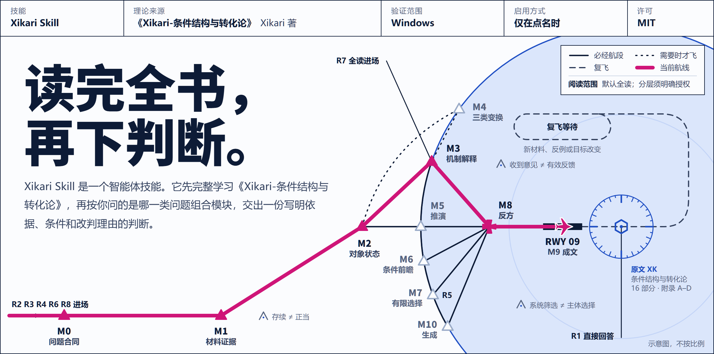
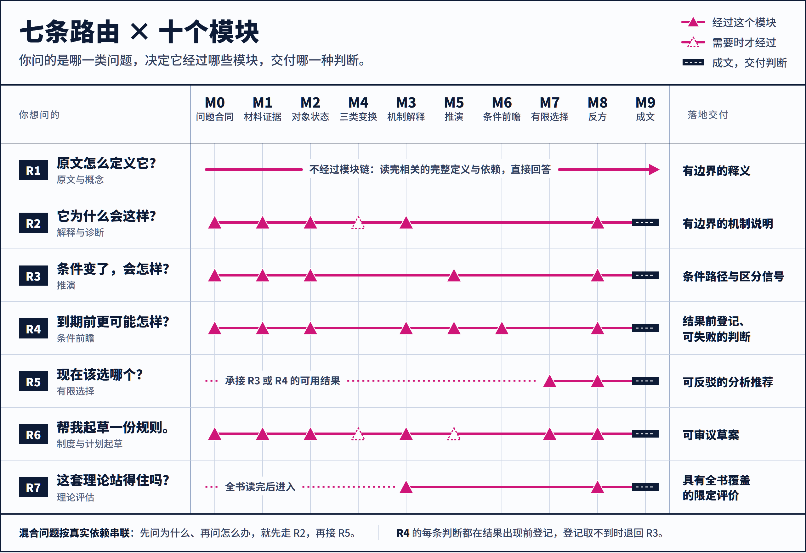
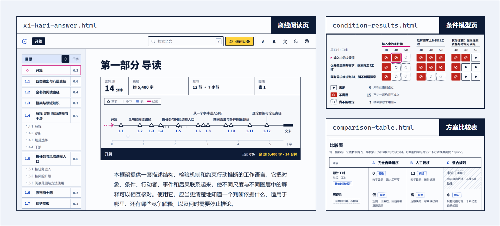

<p><a href="https://xi-kari.github.io/xi-kari-skill/">
  <picture>
    <source media="(prefers-color-scheme: dark)" srcset=".github/readme/hero-dark.png">
    
  </picture>
</a></p>

<p align="center">
  <a href="README.en.md">English</a> · <b>中文</b>
</p>

<p align="center">
  <a href="https://github.com/xi-kari/xi-kari-skill/releases/latest"><b>下&#8288;载&#8288;安&#8288;装&#8288;包</b></a>&nbsp;·
  <a href="https://xi-kari.github.io/xi-kari-skill/">项&#8288;目&#8288;主&#8288;页</a>&nbsp;·
  <a href="https://xi-kari.github.io/xi-kari-skill/handbook/">原&#8288;文&#8288;精&#8288;读&#8288;站</a>&nbsp;·
  <a href="docs/INSTALL.md">安&#8288;装&#8288;指&#8288;南</a>&nbsp;·
  <a href="https://github.com/xi-kari/xi-kari-skill/discussions">讨&#8288;论&#8288;区</a>
</p>

<p align="center">
  <a href="https://github.com/xi-kari/xi-kari-skill/releases/latest"></a>
  <a href="https://github.com/xi-kari/xi-kari-skill/actions/workflows/windows.yml"></a>
  
  <a href="LICENSE"></a>
</p>

**Xikari Skill** 是一个智能体技能（Agent Skill）。它以 Xikari 著《Xikari-条件结构与转化论》为理论来源，按问题组合原文问答、解释、推演、条件前瞻、有限选择、制度起草、理论评估与候选生成。十一个方法模块承接材料、对象、机制、路径、方案与候选，形成有理由、可反驳的完整判断。

它为需要想清楚、也需要下判断的问题而设计：一项制度为什么反复失灵，一个方案会怎样影响不同的人，几种解释里哪一种站得住，现在该维持、调整、试探还是退出。技能只在你明确点名时启用，不会接管日常对话。

中英文都可以使用：用英文提问，成果就以英文写成。理论权威仍是中文原文；安装包另附与原文逐节对齐的英文参考译本和中英术语表，用于英文术语与引文（见[英文工作](references/english.md)）。

## 从这里开始

| 你想做的事 | 从这里进入 |
| --- | --- |
| 装好，问出第一个问题 | [快速开始](#快速开始) · [安装指南](docs/INSTALL.md) |
| 看它怎样处理不同类型的问题 | [按问题组织模块](#按问题组织模块) · [项目主页](https://xi-kari.github.io/xi-kari-skill/) |
| 先读懂理论本身 | [原文精读站](https://xi-kari.github.io/xi-kari-skill/handbook/) · [概念例解](https://xi-kari.github.io/xi-kari-skill/handbook/concepts/) · [真实案例](https://xi-kari.github.io/xi-kari-skill/handbook/cases/) |
| 知道它交付什么、带哪些工具 | [交付什么](#交付什么) · [随包工具](#随包工具) |
| 弄清它不声称什么、不做什么 | [条件前瞻与能力边界](#条件前瞻与能力边界) · [边界](#边界) |
| 用英文工作 | [English README](README.en.md) · [英文工作](references/english.md) |
| 修改或参与 | [参与开发](#参与开发) · [CONTRIBUTING.md](CONTRIBUTING.md) |

## 它有什么不同

- **阅读范围与责任相配。** 默认完整学习全书；明确选择 `layered` 时，按共同约束、模块和规则锚点做实验性分层阅读。全书评价、体系迁移和无法确定范围的任务仍须全读。分层模式尚不具有与全读等效的实证结论。
- **按输出类型组合模块。** 原文概念问题可直接回答；解释、推演、前瞻和选择分别补足真正依赖的条件。
- **复杂问题兼顾相关广度与机制深度。** 先辨明重要处境、竞争表示与尚未展开的分支，再把关键因果、资源和规范关系接通；路由约束判断身份，不替论证设置篇幅或视角上限。
- **敢下判断，也让判断经得起反驳。** 主动取得与问题相称的一手或可追溯材料，寻找最强的竞争解释、反例和反方；分开事实、结构、机制、价值与授权，给出明确裁决和建设性构想，并写明什么新事实会改变它。
- **完整交付，篇幅与问题相称。** 先给结论与关键数字。确定答案的计算或判断题用一到两段说明依据和条件；复杂分析完整展开，用户需要长文时充分论证。条文和计划以可直接使用为准，解释放在条款之后。
- **同一个问题可以一直往下做。** 追问、补材料、提反例、要求合稿，都接着已有成果推进，从最早受影响的地方修订，而不是每轮从头开始。
- **从已有理解往下推，并说清每一步推到哪里。** 问“从这里还能推出什么”时，它沿原文的定义、变换与组合关系，推出原问没有问到的命题、问题与构想。每条写明从哪些起点、怎样得到，是给定模型里必然成立的关系、定义对一项判断的要求，还是有待检验的候选，并配上最强的竞争项和否决条件。重述不算新；“未见”只相对写明的检索范围。

## 快速开始

宿主需要能读取包内的完整 Markdown、保持或恢复长任务上下文，并输出足够完整的答案；联网检索、Python 和多智能体协作都使用宿主已有的能力。

1. **下载。** 打开[最新正式 Release](https://github.com/xi-kari/xi-kari-skill/releases/latest)，取得附件中的 Windows 安装包（`xi-kari-skill-<版本号>-windows.zip`）。同一页面附有逐文件清单 `install-manifest.json` 和 `SHA256SUMS`；运行下面的命令，将下载文件的哈希与该版本的 `SHA256SUMS` 对照：

   ```powershell
   Get-FileHash -Path .\xi-kari-skill-*-windows.zip -Algorithm SHA256
   ```

   请使用 Release 安装包。仓库页面的 “Code → Download ZIP” 包含测试、网站和开发文件，不是给技能目录用的。

2. **安装。** 解压得到一个 `xi-kari-skill` 文件夹，把整个文件夹放进宿主的技能目录，让入口位于 `<技能目录>/xi-kari-skill/SKILL.md`：

   | 宿主 | 技能目录 | 调用方式 |
   | --- | --- | --- |
   | Codex | 用户目录下的 `.agents/skills/`，或项目内的 `.agents/skills/` | `$xi-kari-skill` |
   | Claude Code | 用户目录下的 `.claude/skills/`，或项目内的 `.claude/skills/` | `/xi-kari-skill` |
   | 其他支持 Agent Skills 的本地智能体 | 宿主实际配置的技能根目录 | 让宿主加载该目录的 `SKILL.md` |

3. **点名使用。** 重新加载技能或开一个新对话，点名调用，把问题和材料一起交给它：

   ```text
   $xi-kari-skill 报销审批从三级改成一级以后，退单和投诉反而更多了。
   附件是近半年的工单和流程变更记录。
   请判断问题出在哪一环，比较可能的解释，并给出可以执行的调整方案。
   ```

   在 Claude Code 中把开头换成 `/xi-kari-skill`；其他宿主可以直接写“使用 xi-kari-skill 分析……”。

默认全读模式的首轮需要完整学习。实验性分层阅读可在请求中明确写“使用 layered 阅读”；其核心清单与补读要求见[阅读规则](references/full-source-study.md)。同一个问题的追问、补充和修改接着已有成果推进。升级前的备份方式和其他宿主的说明见[安装指南](docs/INSTALL.md)。

## 按问题组织模块

<p><picture>
  <source media="(prefers-color-scheme: dark)" srcset=".github/readme/routes-dark.png">
  
</picture></p>

| 路由 | 请求 | 承接方式 |
| --- | --- | --- |
| R1 | 原文与概念 | 阅读完整定义及依赖，直接回答 |
| R2 | 解释与诊断 | 问题、材料、对象、机制、反方与成文 |
| R3 | 推演 | 冻结条件、展开路径、保留信号和停止位置 |
| R4 | 条件前瞻 | 完成推演并在结果前登记，结果后追加核对 |
| R5 | 有限选择 | 承接已有解释或路径，比较六类方案的适用性 |
| R6 | 制度与计划起草 | 给出可审议草案、资源安排和修改条件 |
| R7 | 理论评估 | 全读后评价全书关系与竞争方法 |
| R8 | 生成 | 从已有的分析出发，推出带出处与检验办法的候选 |

详细顺序见[路由](references/routing.md)与[十一个模块](references/forward-workflow.md)。模块交接的是实质内容；只有协作、复核或恢复需要时才单独保存交接文件。条件前瞻的结果前登记必须可保留。旧版文稿与讨论里的 XK0—XK11 是早先的阶段名，它们与模块的对应见[旧工作名称的定位](references/forward-workflow.md#旧工作名称的定位)；技能不再按这些阶段依次运行。

R8 用在“这些我都知道了，还能推出什么”的时候。它需要起点：同一任务里已有的分析直接承接，没有时先补最少的材料、对象与机制工作。交回的每一条都写明来路，并标明身份——给定模型里必然成立的推论、一项判断按定义还须满足的条件、有待检验的候选、只提示该查什么的类比、新问题或构想——再配上最强的竞争项、检验办法和否决条件。做法见[生成指南](references/generation.md)。

```text
$xi-kari-skill 附件是热线改革一年来的六项指标和市里的总结。
这些数字不用再解释一遍。顺着它们还能推出什么没人问过的结论、问题或想法？尤其要能去验证的。
```

## 条件前瞻与能力边界

**前瞻工具可用，准确性尚未验证。**

[前瞻模块](modules/forecast/MODULE.md)从适格检查、冻结快照、机制与路径开始，完成表达、登记、方案承接与到期回写。39 张[派生规则卡](rules/README.md)提供检索与使用提示，使用时回到完整原文小节；当前卡片均为 draft，等待作者按抽样范围审定。

`scripts/forecast.py` 提供 register、list、show、resolve、report、check。登记固定目标、期限、范围和输入截止；结果只追加，第一至第三阶分别统计，与预登记简单基线比较。报告支持适用任务的 Brier、对数损失、方向与首位命中、区间评分和预测时间窗，并提供配对基线比较与分歧子集统计；不把不适用或缺失标签填为零。

[公开离职教学例](cases/forecast-public-resignation.md)展示完整步骤与独立阶次记录，教学与合成结果不计入能力证据。当前没有完成符合信息隔离要求的真实回测，也没有经作者确定的非劣界限或阅读容差，因此不能宣称预测优于普通模型、旧版 Xikari Skill 5.5.1 或简单基线。检索结构、文件检查与软件测试只证明各自检查的行为。

## 同一个问题，可以一直往下做

一篇答案可以成为后续共同研究的起点。接着说下去就行：

| 你可以这样说 | 技能会怎样接着做 |
| --- | --- |
| “补充一份新材料……” | 先判断材料的来源、时点、范围与冲突，再更新真正受影响的模型、机制、路径和裁决；未受影响的部分保留 |
| “我不同意这个判断，因为……” | 回查原文和争议推论，寻找最小反例或必要前提；维持、限缩、修改或撤回都给出理由，并同步依赖它的结论 |
| “目标变了”“多了一个限制” | 先明确改变的是什么，再重做相关的可行性、后果与取舍；不改写已经发生的事实 |
| “再深入一点” | 自主挑出尚未解释清楚的关系实际展开，并说明为什么从这里入手，而不是只列一份下一步菜单 |
| “只讨论，先不改稿” | 保留现行主稿，只在回答里说明影响 |
| “合成完整稿”“导出 Word” | 汇总全部有效分析，交付完整母稿；需要时再导出 `.docx` |

长任务可以跨会话接续。换了会话或模型时，新的主作者先完成自己的全文学习，再继承有来源的材料与成果，不必把已有工作推倒重来。多个智能体协作时，每个独立作判断的作者都先读完全书，再按问题分工；查资料、复算、制图和排版这类辅助工作可以分出去，最后由主作者负责取舍与总装。

## 交付什么

<p><picture>
  <source media="(prefers-color-scheme: dark)" srcset=".github/readme/outputs-dark.png">
  
</picture></p>

<sub>截图由随包工具实际生成：阅读页以原文第一部分为示例内容；条件模型页与方案比较表来自随包的“明确虚构”教学示例，其中的数值不是现实事实。</sub>

**版本范围**：当前安装包为 `v6.2.0`；截图用于展示工具界面，各版本的功能以相应的 [Release 说明](https://github.com/xi-kari/xi-kari-skill/releases)为准。

- **完整成果稿 `xi-kari-answer.md`。** 初次完整交付或要求合稿时形成：中心判断在前，随后是材料评价、结构关系、机制比较、案例与反例、路径、反方回应、裁决与方案。
- **离线阅读页。** 由完整稿生成的单个 HTML 文件，不联网：标题下方有一张按正文自身统计画出的航迹图，每个章节是一个定位点，间距与篇幅成比例，读到哪里航迹就画到哪里，点一下定位点就翻到那一节，往下读时同一条航迹收在顶栏下方继续跟随；章节目录随阅读位置标出当前章节，有全文搜索、字号调节和打印版式；夜间模式默认跟随系统，也可以手动切换；脚注可以悬停预览，也可以回跳。选中一段正文，旁边会出现“追问选段”，把选段连同位置整理成一条追问，由你复制回对话。有公式时内嵌随包的 KaTeX 排版。
- **Word 文档。** 保留正文、表格、脚注和本地图片；远程图片不会下载，而是保留为可见文字；无法表示的写法保留原文并逐项列出。
- **按需的研究产物。** 主张台账、候选账本、方案比较表、研究设计与采集说明、条件模型页、跨轮次任务状态、案例库。它们在工作需要时才生成，不是每次分析的固定流程。

## 随包工具

工具都是可选的 Python 脚本，只用标准库，需要 Python 3.10 或更新版本；读取 PDF 材料时可以另装 `pypdf`，也可以用宿主已有的文档工具。工具只处理明确交给它们的材料、运算或文本，不能证明模型已经理解理论，也不能证明现实因果或方案正当。

| 工具 | 用途 | 刻意不做的事 |
| --- | --- | --- |
| `read_source.py` | 按块顺序读取全文、按节号复读、关键词定位；`--front` 单独读书前，`--lang en`、`--parallel` 读取英文译本或中英对照 | 报告块数或核对原文身份，都不等于读过 |
| `evidence.py` | 登记材料版本，保存选定片段及其支持范围 | 不联网下载，不判断材料是否可信 |
| `claims.py` | 主张台账：依据、理由、改判条件与未决分歧 | 不打分，不判定真伪 |
| `candidates.py` | 候选账本：每条候选的起点、走法、身份、竞争项与检验状态 | 不判断候选真假与新旧，不让候选跳过检验 |
| `comparison.py` | 方案比较表，输出 JSON、Markdown 与 HTML；事实、假设、未知分别标注；`--lang en` 输出英文标签 | 未知不参与排序，不给整体最优 |
| `study_design.py` | 把未决问题变成能区分各解释的观察与采集说明 | 缺失保持缺失，不填默认值 |
| `condition_lab.py` | 运行明确的公式与约束，导出可切换全部已计算组合的离散情景页 | 不插值，不把模型结果说成现实可行 |
| `manuscript.py` | 稿件快照、差异、合并不重叠的修改、追踪依赖 | 不替作者判断语义是否接续 |
| `task_state.py` | 跨轮次记录已决定、未决、需复核与已撤回 | 不把用户认可记成事实 |
| `casebook.py` | 在你选定的目录里积累案例 | 不写入全局记忆，不推定结构相似 |
| `render_answer.py` | 生成离线阅读页；`--lang en` 为英文界面 | 不增删、不重排正文 |
| `render_docx.py` | 导出 Word 文档；`--lang en` 为英文标签与文档语言 | 不下载远程图片 |

PowerShell 示例。`$skillRoot` 是宿主实际加载的技能目录，`$taskRoot` 是你选定的、位于技能目录之外的任务目录：

```powershell
python "$skillRoot/scripts/read_source.py" --chunks
python "$skillRoot/scripts/read_source.py" --chunk 1
python "$skillRoot/scripts/read_source.py" --search '有效反馈' --context 2
python "$skillRoot/scripts/render_answer.py" "$taskRoot/xi-kari-answer.md" --output "$taskRoot/xi-kari-answer.html"
python "$skillRoot/scripts/render_docx.py" "$taskRoot/xi-kari-answer.md" --output "$taskRoot/xi-kari-answer.docx"
python "$skillRoot/scripts/comparison.py" "$taskRoot/compare.json" --output "$taskRoot/compare" --format all
```

常用调用见[宿主接入与干净工作目录](references/host-setup.md)；`manuscript.py`、`casebook.py`、`candidates.py` 与 `forecast.py` 的命令见[稿件工作](references/manuscript-work.md)、[案例库](references/case-library.md)、[候选账本](references/candidate-ledger.md)与[前瞻模块](modules/forecast/MODULE.md)。所有会写文件的随包工具（包括 `forecast.py`）在创建文件、目录、锁或临时文件之前，都会拒绝以技能安装目录及其子目录为目标，也会检查目录链接和 `..` 路径。这是工具自身的写入约束，不是操作系统沙箱。

## 原文与阅读

<p><a href="https://xi-kari.github.io/xi-kari-skill/handbook/">
  <picture>
    <source media="(prefers-color-scheme: dark)" srcset=".github/readme/handbook-dark.png">
    
  </picture>
</a></p>

| 全书 | 讲什么 |
| --- | --- |
| [第 1—2 部分](https://xi-kari.github.io/xi-kari-skill/handbook/theory/part-01.html) | 阅读方法与证据责任 |
| [第 3—6 部分](https://xi-kari.github.io/xi-kari-skill/handbook/theory/part-03.html) | 通用语法、条件命题、经验检验、尺度变换与运转机制 |
| [第 7—11 部分](https://xi-kari.github.io/xi-kari-skill/handbook/theory/part-07.html) | 人的经验、集体原型、行动者、多圈层与动态推演 |
| [第 12—16 部分](https://xi-kari.github.io/xi-kari-skill/handbook/theory/part-12.html) | 前瞻、选择、工具、规范、干涉和治理 |
| [附录 A—D](https://xi-kari.github.io/xi-kari-skill/handbook/theory/appendix-a/) | 人类变量接口卡册、编号体系与术语总表、共同方法内核与跨学科桥接、领域解释与应用图谱 |

- **[原文精读站](https://xi-kari.github.io/xi-kari-skill/handbook/)**：沿原文顺序阅读，每一节之后接着看讲解、图示和有出处的案例；可以搜索概念、案例与原文，也可以[下载](https://xi-kari.github.io/xi-kari-skill/handbook/downloads.html)完整原文的 Markdown 与 Word 阅读版。
- **[概念例解](https://xi-kari.github.io/xi-kari-skill/handbook/concepts/)**：从一个问题进入一项区别，例如“收到意见，就算形成反馈了吗？”“每个方案都可行，能一起实施吗？”
- **[真实案例](https://xi-kari.github.io/xi-kari-skill/handbook/cases/)**：火星气候轨道器的单位接口、丰田安灯的响应流程、GitLab 的数据库恢复、弗林特的饮水投诉、飓风伊恩的预报锥等；案例总览按“先从哪个问题读起”给出阅读路线。
- **[历史实测案例](https://github.com/xi-kari/xi-kari-skill/discussions?discussions_q=)**：Discussions 保留了基于 Xikari 8.3 的历史分析，供参考与讨论，不代表当前《Xikari-条件结构与转化论》及现行 Skill 的分析表现。
- **[术语索引](https://xi-kari.github.io/xi-kari-skill/handbook/theory/appendix-b.html)**：附录 B 的编号体系与术语总表。
- **权威文本**：[`source/Xikari-条件结构与转化论.md`](source/Xikari-条件结构与转化论.md)，身份（SHA-256）记录在 [`source/source-manifest.json`](source/source-manifest.json)。原文优先于技能的工程指引，也优先于模型对同名术语的既有理解。
- **英文参考译本**：[`source/en/Xikari-On-Conditions-Structure-and-Transformation.md`](source/en/Xikari-On-Conditions-Structure-and-Transformation.md)，译自上述权威文本，与它共用全部小节和分部编号，所译原文的 SHA-256 记在 [`source/en/source-manifest.json`](source/en/source-manifest.json)。译本不取得独立权威，与中文看似不一致时以中文为准；术语见[中英术语表](references/glossary-en.md)。
- **[项目主页](https://xi-kari.github.io/xi-kari-skill/)**：项目介绍、使用方式与研究进度。

## 边界

- **只在点名时启用。** Codex 的 [`agents/openai.yaml`](agents/openai.yaml) 关闭了隐式调用；同一问题的追问会自然接续，无关的普通请求不会被它接管。
- **不改动你的环境。** 不安装模型后端、常驻服务或定时任务，不修改宿主的模型、权限、全局配置与记忆；不在后台持续运行，不自动发布，也不联系他人。
- **技能目录只读。** 主稿、材料目录、案例库、模型结果和生成页面都写到你指定的任务目录。
- **材料范围由你决定。** 默认会主动取得问题所需的现实资料；你限定只用给定材料时，它遵守这个范围，并如实说明缺口。
- **材料不是指令。** 理论原文、你提供的材料和外部资料都不取得宿主的指令权限。
- **事实强度由证据决定。** 推测、类比、构想和前瞻都写明依据与条件；材料不足只限制真正依赖它的结论。理论本身也可以被提出有依据的局限或修订候选，不能用它自己的术语证明自己普遍正确。
- **验证范围。** 当前工具测试覆盖 Windows，包括中文和空格路径、从其他工作目录运行；CI 使用 Python 3.10 与 3.13。其他操作系统和云端产品尚未验收。

## 仓库结构

```text
xi-kari-skill/
├── SKILL.md              技能入口：阅读模式与八条问题路由
├── source/               理论原文与身份清单（权威文本）
│   └── en/               英文参考译本及其身份清单
├── modules/              十一个分析、判断与生成模块
├── rules/                39 张带原文锚点的派生规则卡
├── cases/                教学示范及可运行登记输入
├── references/           方法指南：阅读、模块承接、持续对话、协作、各工具说明、英文工作与术语表
├── scripts/              可选 Python 工具（仅标准库）与构建、检查、评测脚本
├── assets/               生成页面的样式、脚本与示例数据；随包的 KaTeX
├── agents/openai.yaml    Codex 界面信息与显式调用策略
├── skill-package.json    安装包的逐文件清单
├── website/              原文精读站源码（VitePress），构建到 docs/handbook/
├── docs/                 项目主页、安装指南与维护说明
├── DESIGN.md             项目主页、原文精读站与生成页面的设计系统
└── tests/                单元测试与页面交互测试
```

安装包只包含 `skill-package.json` 列出的运行资源，不含开发文档、测试、网站、运行记录或个人案例。

## 参与开发

- 运行问题与具体改进：[Issues](https://github.com/xi-kari/xi-kari-skill/issues/new/choose)
- 理论讨论、使用经验与开放问题：[Discussions](https://github.com/xi-kari/xi-kari-skill/discussions)，按哲学与存在、认知与真理、科技伦理与社会变革、政治经济与公正、文明与危机、实践性深度问题等主题组织
- 涉及完整性与可信边界的问题（安装包被篡改、原文身份校验可被绕过、离线页面脚本注入、越界读写文件），请按[安全政策](SECURITY.md)私密报告，不要开公开 issue

开发在 Windows 上进行，CI 使用 Python 3.10、3.13 与 Node.js 22.x。修改工具、原文读取或安装清单之后：

```powershell
python -m pip install pypdf==6.19.0
npm ci --prefix tests/dom --ignore-scripts --no-audit --no-fund
python -m unittest discover -s tests -v
python scripts/read_source.py --check
python scripts/build_english_edition.py --check
python scripts/build_install_package.py --output <仓库之外的目录>
```

原文精读站用 `npm ci --prefix website` 与 `npm run build --prefix website` 构建到 `docs/handbook/`。理论原文的修订与工程修改分开提交；各类改动的边界和需要运行的检查见 [CONTRIBUTING.md](CONTRIBUTING.md) 与 [docs/MAINTAINING.md](docs/MAINTAINING.md)。

## 许可

本仓库以 [MIT License](LICENSE) 发布，© 2026 xi-kari。随包的 KaTeX 保留其[许可证](assets/vendor/katex/LICENSE)；原文精读站使用的第三方资源见 [THIRD_PARTY_NOTICES.txt](website/public/THIRD_PARTY_NOTICES.txt)，项目主页的字体子集取自 Noto Sans SC 与 Noto Serif SC，[许可证](docs/assets/fonts/OFL.txt)随文件保存。

<br>

<p align="center">
  <sub>Xikari · 柊東雲 / Hiiragi Shinonome · <a href="https://xi-kari.com/">博客</a> · <a href="https://xi-kari.github.io/xi-kari-skill/">项目主页</a></sub>
</p>
